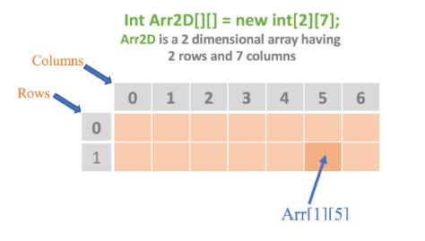

## 💻 *Arrays in Practice*

### What is Array
*- Arrays are used to store homogenous elements/values*\
*- Can access the elements by the indexes.*\
*- Index always start from zero (0).*\
*- Arrays can be single or multi dimensional*

